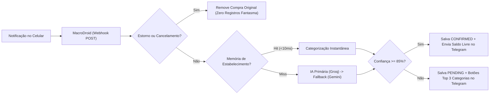

# Manual de Operação e Arquitetura — FinControl (Zero-Input Expense Tracker)

> **Ambiente de Produção:** `https://fincontrol.reagiu.com.br`  
> **Stack em Produção (Hostinger):** PHP 8.2 + SQLite WAL (`zero-input-expense-tracker-hostinger`)  
> **Stack de Referência / Testes Automatizados:** Python 3.12 + FastAPI + Pytest (`zero-input-expense-tracker`)

---

## 1. Como o FinControl Calcula o Seu Saldo Livre

Diferente de planilhas e apps tradicionais que só mostram o passado, o FinControl opera por **Provisão Antecipada no Dia 1º**:

$$\text{Saldo Livre Atual} = \text{Receita Total} - (\text{Custos Fixos \& Médias} + \text{Gastos Variáveis})$$

1. **No dia 1º de cada mês**, o sistema provisiona automaticamente todos os itens ativos do seu **Planejamento Anual**:
   - **Receitas Fixas** entram como `CONFIRMED` (ex.: `Salário Líquido`).
   - **Custos Fixos (`FIXED`)** e **Contas de Consumo (`ROLLING_AVERAGE`)** entram como `ESTIMATED` (já aplicando o rateio `50/50` nos itens compartilhados, como `Financiamento Apto`, `Condomínio` e `Diarista`).
2. **Ao longo do mês**, cada compra no cartão ou PIX capturada do celular (ou importada via CSV) abate imediatamente do **Saldo Livre Atual**.
3. **Quando a conta real de luz/gás chega**, você confirma o valor pago em 1 clique: o sistema **substitui** a estimativa daquele mês (sem duplicar) e recalcula a **média móvel dos últimos 3 meses confirmados** para os meses seguintes.

---

## 2. Operação Diária no Celular (Zero-Input + Telegram)

### 2.1Fluxo Automático de Notificações (MacroDroid → FinControl → Telegram)
Toda vez que o celular recebe uma notificação bancária (Nubank, Inter, Itaú, NuPay, Google Pay, etc.):



- **Limpeza automática de nomes:** prefixos de maquininha/gateway (`Dl*`, `Mp *`, `Pag*`, `IFD*`) são removidos e carteiras digitais (`NuPay`, `Google Pay`) são ignoradas quando o estabelecimento real consta na mensagem (ex.: *"com NuPay APROVADO em 99"* é registrado como **`99`** em **`Transporte/Viagem`**).
- **Deduplicação em 3 camadas:**
  1. **Janela de 3 minutos:** evita duplicar quando a mesma compra gera alerta na carteira digital e no app do banco.
  2. **Assinaturas fixas no cartão (`± R$ 1,00`):** quando a cobrança do `Google AI Pro (5 TB)` chega no cartão, o sistema reconhece o item `FIXED_PLAN` já provisionado no mês, muda o status para `CONFIRMED` e não duplica.
  3. **Estornos automáticos:** se uma corrida ou compra for cancelada logo após a aprovação (ex.: *"A compra em Uber no valor de R$ 13,97 foi estornada"*), o sistema localiza e exclui a compra original dos últimos 30 dias sem criar receita ou despesa artificial.

---

### 2.2 Comandos do Bot no Telegram

Você pode consultar, categorizar, renomear e excluir lançamentos diretamente na conversa com o bot:

| Comando | O que faz | Exemplo prático |
| :--- | :--- | :--- |
| `/saldo` ou `/resumo` | Exibe Receitas, Fixos & Médias, Variáveis e o **Saldo Livre** do mês atual. | `/saldo` |
| `/ultimos` (ou `/listar`, `/gastos`) | Lista os últimos 8 lançamentos do mês com `#ID` e botões **`✏️ #ID`** para editar categoria em 1 toque. | `/ultimos` |
| `/buscar <termo>` | Filtra lançamentos do mês por estabelecimento ou categoria e exibe botões de edição. | `/buscar uber` |
| `/editar <ID>` | Abre o teclado com todas as categorias para o lançamento `#ID`. | `/editar 45` |
| `/editar <ID> <Nome> \| <Categoria>` | Renomeia o estabelecimento, altera a categoria (criando-a se for nova) e **ensina a memória do bot** para as próximas compras. | `/editar 45 99 \| Transporte/Viagem` |
| `/excluir <ID>` | Remove o lançamento `#ID` do banco e informa o novo Saldo Livre. | `/excluir 45` |
| `/ajuda` | Lista todos os comandos disponíveis. | `/ajuda` |

---

## 3. Guia do Dashboard Web (`https://fincontrol.reagiu.com.br`)

### 3.1 Visão Geral (`/dashboard`)
- **Seletor de Competência (`YYYY-MM`):** no topo, alterne entre qualquer mês do ano (ex.: `2026-11`, `2026-12`).
- **Botões `▸ Recolher blocos` / `▾ Expandir blocos`:** permite fechar ou abrir as seções do painel (a preferência fica salva no navegador do seu celular).
- **4 KPIs Principais (Grid 2x2 no Mobile):**
  1. **Receita Total:** Salário líquido + receitas extras/estornos parciais.
  2. **Fixos & Médias:** Soma da sua parte nos custos fixos e contas de consumo provisionadas/confirmadas.
  3. **Variáveis (Cartão):** Soma da sua parte nas compras de cartão, PIX avulsos e faturas importadas.
  4. **Saldo Livre Atual:** Quanto resta disponível para gastar no mês.
- **Contas de Consumo (Média vs. Real):**
  - Exibe `Energia (Enel)` e `Naturgy (Gás)` com o status atual (`Estimado` ou `Real`) e a **Média 3M**.
  - Digite o valor real da fatura e toque em **Confirmar Real** para substituir a estimativa e atualizar a média móvel.
- **Visão do Ano por Mês:** gráfico comparativo de 2 dimensões (**Receita** vs. **Despesa**) e tabela mensal ordenável de Janeiro a Dezembro.

---

### 3.2 Rateio 50/50 ("Settle Up") — Individual e em Massa
Para despesas divididas com outra pessoa (como condomínio, financiamento, diarista ou mercado):
1. **No Planejamento Anual:** toque no botão **`100%`** na coluna *Rateio / Ação* para alternar para **`50/50`** (e vice-versa). Isso já atualiza o lançamento provisionado no mês atual sem recarregar a página.
2. **Nas Transações Recentes ou em Gastos Detalhados (`/transactions`):**
   - **Individual (1 toque sem reload):** toque no botão **`÷2`** ao lado de qualquer despesa para alternar entre `100%` e `50% de R$ ...` via AJAX, mantendo sua posição de rolagem e atualizando os KPIs instantaneamente.
   - **Em Massa (Bulk Split Edit em `/transactions`):** marque as caixas de seleção à esquerda das despesas desejadas (ou o checkbox do topo para selecionar todas as filtradas) e toque em **`Aplicar 50/50 Settle Up`** ou **`Aplicar 100% Meu`** na barra flutuante.

---

### 3.3 Criação de Categorias Personalizadas e Edição de Lançamentos
- **Criar nova categoria:** em qualquer seletor de categoria (Planejamento Anual inline, Adicionar Plano, Lançamento Rápido ou Modal Editar Despesa), escolha a última opção **`+ Nova categoria...`**, digite o nome e salve. Ela passa a existir em todos os filtros e menus do sistema.
- **Editar ou mover uma despesa de mês:** toque em **`Editar`** em qualquer lançamento para:
  - Corrigir o **Título / Estabelecimento**;
  - Trocar ou criar uma **Categoria**;
  - Alterar a **Data (Competência)** (ex.: mover uma compra feita no fim do mês para a competência da próxima fatura);
  - **Excluir** o lançamento.

---

### 3.4 Importação de Fatura Nubank CSV (`📄 Importar Fatura`)
1. No topo do Dashboard, toque em **`📄 Importar Fatura`**.
2. Selecione o arquivo `.csv` exportado do Nubank **ou** cole o texto `date,title,amount` diretamente na caixa de texto.
3. Escolha a **Competência da Fatura** (ex.: `2026-11` para a fatura paga em Novembro, `2026-12` para a fatura paga em Dezembro).
4. Mantenha marcada a opção **"Dividir 50/50 automaticamente compras de Mercado/Casa (Settle Up)"** se desejar que supermercados e itens de casa já entrem rateados pela metade.
5. O importador automaticamente:
   - Ignora a linha `"Pagamento recebido"` da fatura anterior;
   - Anula pares de compra + estorno de mesmo valor dentro da fatura;
   - Reconcilia itens fixos no cartão (`Google AI Pro R$ 96,99`) sem duplicar;
   - Limpa os nomes dos estabelecimentos e aplica a memória de categorias.

---

## 4. Configuração de Automação (MacroDroid & Cron)

### 4.1 MacroDroid (Gatilho de Notificação no Android)
- **Gatilho:** Notificação Recebida → Apps selecionados: *Nubank, Inter, Itaú, Carteira do Google, etc.* (Ignorar notificações em andamento).
- **Ação:** Requisição HTTP (`POST`)
  - **URL:** `https://fincontrol.reagiu.com.br/api/v1/webhook/notification`
  - **Content-Type:** `application/json`
  - **Cabeçalho HTTP (Header):** `X-API-Key: <SUA_API_SECRET_KEY>`
  - **Corpo (Body JSON):**
    ```json
    {
      "app": "{not_app_package}",
      "title": "{not_title}",
      "text": "{not_text}",
      "timestamp": "{year}-{month_digit}-{dayofmonth}T{hour}:{minute}:{second}-03:00"
    }
    ```

### 4.2 Cron Diário na Hostinger
- Configurado para rodar diariamente às `09:00` (`0 9 * * *`), chamando `POST /api/v1/cron/daily` com o header `X-API-Key` para garantir a provisão idempotente na virada de cada mês.

---

## 5. Segurança e Manutenção Técnica

- **Proteção de Login:** cookie de sessão assinado com `HMAC-SHA256` (`HttpOnly`, `SameSite=Lax`, `Secure`) + rate limit contra força bruta na tabela `login_attempts` (bloqueio temporário de 15 minutos após 5 tentativas inválidas por IP).
- **Proteção de Webhooks e API:** validação em tempo constante (`hash_equals`) do header `X-API-Key` e do header `X-Telegram-Bot-Api-Secret-Token`.
- **Isolamento do Banco SQLite:** armazenado em `data/finance.db` (modo WAL) com bloqueio `.htaccess` (`Deny from all`) contra download direto.
- **Fluxo de Deploy (Git → Hostinger):**
  1. No repositório `PESSOAL`, sincronize via `git pull origin main` / `git push origin main`.
  2. As credenciais reais residem apenas em `config.php` (ignorado pelo Git via `.gitignore`).
