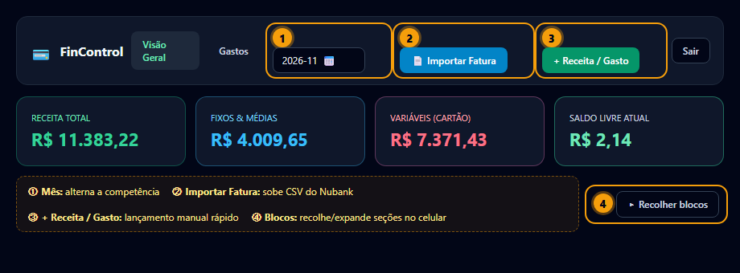
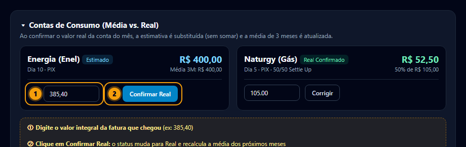
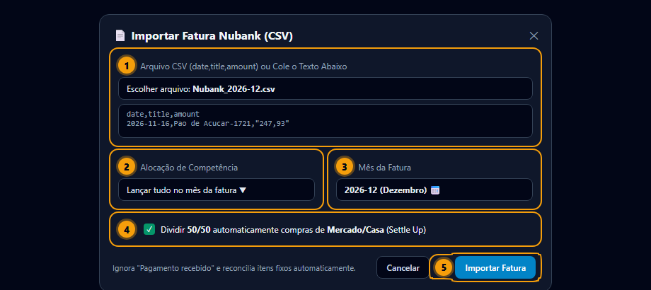
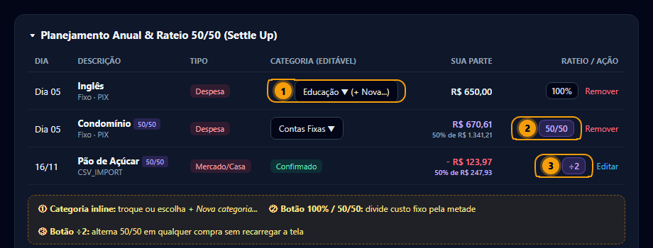
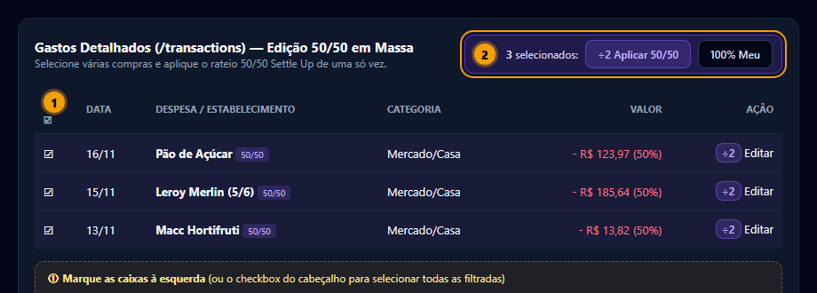
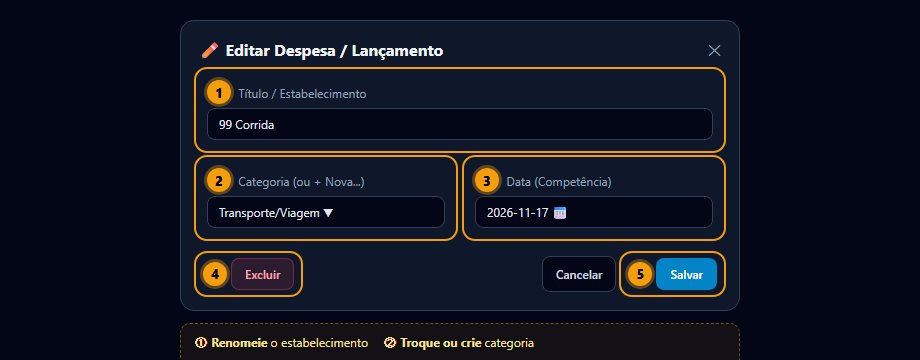
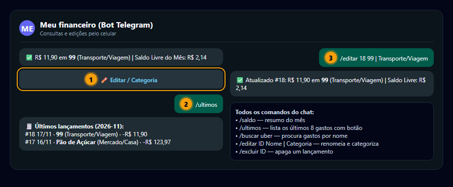

# Manual de Ajuda do Usuário — FinControl

Disponível no painel em: `https://fincontrol.reagiu.com.br/manual` (botão **Ajuda** / **`?`** no topo do Dashboard).

---

## 1. Como navegar pelo topo e recolher blocos

- **① Seletor de Mês:** escolha qualquer mês (`2026-11`, `2026-12`, etc.) para ver os gastos e o Saldo Livre daquela competência.
- **② `📄 Importar Fatura`:** abre a janela para enviar o CSV da fatura do Nubank.
- **③ `+ Receita / Gasto`:** lança uma receita extra (13º, reembolso, bônus) ou despesa manual.
- **④ `▸ Recolher blocos` / `▾ Expandir blocos`:** fecha ou abre todas as seções da tela para facilitar o uso no celular.

---

## 2. Como atualizar o valor real da Enel (Luz) e Naturgy (Gás)

1. No campo **①**, digite o valor integral da conta que chegou no mês.
2. Clique em **② `Confirmar Real`** (ou **`Corrigir`**).
3. O sistema **substitui** o valor estimado pelo valor real (sem somar os dois) e recalcula automaticamente a média de 3 meses para os meses seguintes.

---

## 3. Como importar a fatura do cartão Nubank (CSV)

1. **① Arquivo ou Texto:** escolha o arquivo `.csv` exportado do Nubank ou cole o texto `date,title,amount`.
2. **② e ③ Competência da Fatura:** deixe em *"Lançar tudo no mês da fatura"* e selecione o mês em que a fatura será paga (ex.: `2026-12` para a fatura que vence em Dezembro).
3. **④ Rateio automático de mercado:** mantenha marcada a opção *"Dividir 50/50 automaticamente compras de Mercado/Casa (Settle Up)"* para que compras de supermercado já entrem pela metade.
4. **⑤ `Importar Fatura`:** clique para concluir. O sistema ignora *"Pagamento recebido"* e não duplica o *Google AI Pro*.

---

## 4. Como dividir despesas 50/50 (Settle Up) e trocar categoria fixa

- **① Trocar categoria de custo fixo:** na tabela *Planejamento Anual*, clique direto na categoria para trocar ou escolha `+ Nova categoria...`.
- **② Rateio 50/50 em custo fixo:** clique no botão **`100%`** / **`50/50`** na linha do custo fixo (ex.: Condomínio, Financiamento, Diarista).
- **③ Rateio 50/50 em uma compra avulsa:** na lista de transações, toque no botão **`÷2`** para dividir por 2 na hora sem recarregar a página.

---

## 5. Como dividir 50/50 várias compras de uma só vez (Edição em Massa)

1. Acesse a aba **Gastos** (`/transactions`) e filtre as despesas desejadas.
2. **① Marque as caixas à esquerda** das compras compartilhadas (ou o checkbox do cabeçalho para selecionar todas as filtradas).
3. **② Clique em `÷2 Aplicar 50/50`** (ou **`100% Meu`**) na barra que aparece no topo da lista.

---

## 6. Como editar nome, criar categoria, mudar de mês ou excluir um gasto

Toque em **`Editar`** em qualquer lançamento para abrir a janela acima:
- **① Título / Estabelecimento:** corrija o nome da loja/despesa.
- **② Categoria:** selecione outra categoria ou escolha `+ Nova categoria...` para criar uma nova.
- **③ Data (Competência):** altere a data caso queira mover uma compra de um mês para outro.
- **④ `Excluir` / ⑤ `Salvar`:** apague um registro indevido ou salve as alterações.

---

## 7. Como consultar e editar gastos pelo Bot do Telegram

- **① Botão `✏️ Editar / Categoria`:** aparece abaixo de cada gasto confirmado. Toque nele para escolher a categoria correta por botão.
- **② `/ultimos` ou `/buscar <termo>`:** lista os gastos recentes (ex.: `/buscar uber`) mostrando o número `#ID` de cada lançamento.
- **③ `/editar <ID> <Novo Nome> | <Categoria>`:** renomeia, troca a categoria e já ensina a memória do bot para as próximas compras (ex.: `/editar 18 99 | Transporte/Viagem`).
- **`/excluir <ID>`:** remove o lançamento `#ID` e mostra o Saldo Livre atualizado.
- **`/saldo`:** exibe o resumo do mês atual.
